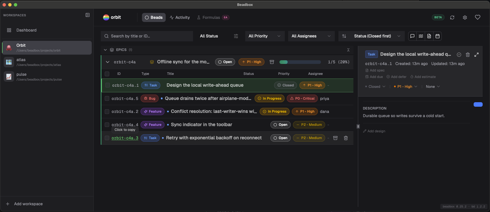
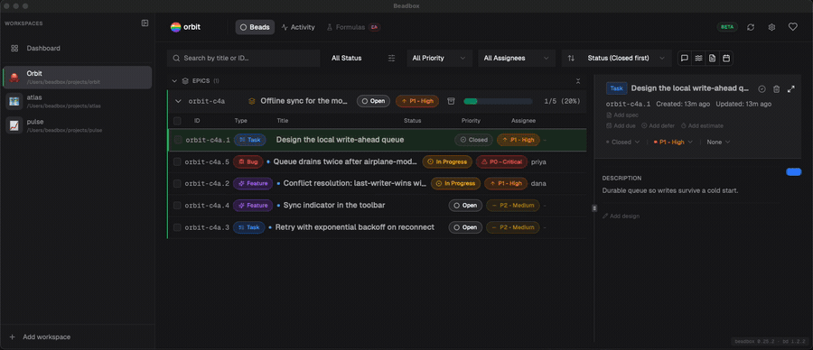

# Beadbox

> Beadbox has a sister project, [initech](https://github.com/nmelo/initech) — a runtime for agents that collaborate with each other from one terminal, optimized for steerability.
> Beadbox is built and maintained with it; worth a look.

A fast, native GUI for the [beads](https://github.com/gastownhall/beads) issue tracker.

Beadbox gives `bd` users a visual interface for the things a terminal can't show well — epic trees, dependency structure, pipeline state, and live activity — without making simple operations slower than typing `bd show`.





## Features

- **Epic tree** — hierarchical view of epics and child beads with status, priority, and progress at a glance
- **Chart** — a timeline per epic: when work on each bead started and closed, what is planned after what, and what blocks what; same filters as the Beads view
- **Trains** — `.beadtrain` files in the workspace `.beads/` folder: ready cars, coupler joins, click through to the bead
- **Waiting** — open `bd` gates (human, timer, gh:run, gh:pr, bead), oldest first, with the work each one holds; resolve a human gate in place. The tab (⌘6) appears only while a gate is open
- **Live updates** — changes made from the `bd` CLI appear in the UI in real time; no refresh
- **Bead detail** — full descriptions, comments, dependencies, and workflow advancement in a side panel or modal
- **Filters** — slice by status, type, priority, assignee, and label (any selected label matches); filters persist across sessions, and label selections clear when switching workspaces
- **Activity feed** — a timeline of what changed, by whom, across the workspace
- **Multi-workspace** — a rail of project tabs switches between local `.beads/` projects and remote Dolt servers; rename a tab, give it an emoji, and switching back is instant
- **Keyboard-first** — power-user paths work without touching the mouse

## Install

**Requires the [beads](https://github.com/gastownhall/beads) CLI, version 1.1.0 or newer** (`brew install beads`). Beadbox is a GUI over `bd`; issue data lives in your beads database. `.beadtrain` files in `.beads/` are optional plans (see [Beadtrains](https://github.com/acrinym/Beadtrains)) shown on the Trains tab.

### macOS

```sh
brew install --cask beadbox/cask/beadbox
```

Or download the DMG (Apple Silicon) from [Releases](https://github.com/beadbox/beadbox/releases). Builds are signed and notarized.

### Linux and Windows

Download packages from [Releases](https://github.com/beadbox/beadbox/releases).

More at [beadbox.app](https://beadbox.app).

## Build from source

Prerequisites: [Bun](https://bun.sh), [Rust](https://rustup.rs) (stable), Node.js, and the platform prerequisites for [Tauri v2](https://v2.tauri.app/start/prerequisites/).

```sh
git clone https://github.com/beadbox/beadbox.git
cd beadbox
bun install

# Run the desktop app in development
bun run tauri:dev

# Or run the web client + server without the native shell
bun run dev

# Build a release bundle
bun run tauri:build
```

### Local macOS build, isolated from an installed Beadbox

To try a change in a real app on macOS without touching an installed Beadbox,
build a separate, locally signed copy:

```sh
bash scripts/build-local-macos.sh
```

Nothing is installed. The app stays in the build tree at
`src-tauri/target/release/bundle/macos/Beadbox Local.app`, with a scratch
profile beside it in `src-tauri/target/local-profile/`. Open it from Finder
or with:

```sh
open -n "src-tauri/target/release/bundle/macos/Beadbox Local.app"
```

How it stays separate from the installed app:

- **Own bundle identifier** (`app.beadbox.local`) and name, so macOS keeps its
  window, WebView and app-data state apart from the installed Beadbox.
- **Scratch workspace registry.** The app's `Info.plist` (`LSEnvironment`)
  points `BEADBOX_REGISTRY_PATH` at
  `src-tauri/target/local-profile/registry.json` and `BEADS_REGISTRY_PATH` at a
  file in the same folder, so the app neither reads your registered workspaces
  nor imports them from the legacy `~/.beads/registry.json` on first run. It starts with no workspaces; add a test workspace from inside the app.
- **Own sidecar log** at `src-tauri/target/local-profile/sidecar.log` (via
  `BEADBOX_LOG_PATH`) instead of `~/Library/Logs/Beadbox/`.
- **No updates.** The build has no update endpoint, so it cannot replace itself
  with a release build; the update check reports that it failed.
- **No analytics.** The build blanks the analytics key.

What it still shares or leaves behind:

- The installed `bd`. Any workspace you add in the local app is a real
  workspace on disk; opening one of your real workspaces from both apps at
  once works, but edits from either land in the same database.
- Saved server-workspace credentials live in the same macOS keychain service
  (`beadbox`) as the installed app.
- macOS and WebKit create per-app folders for `app.beadbox.local` (for example
  under `~/Library/WebKit` and `~/Library/Caches`) when it first launches. They
  are separate from the installed app's; delete them with the build if you
  want a clean slate.
- The build uses the usual toolchain caches (`~/.cargo`, `~/.bun`).

The signature is ad hoc and the build is not notarized; it is for your own
machine only. The scratch paths are absolute and baked into the bundle at build
time: if you move the repository, rebuild. They apply whenever macOS opens the
app (Finder, Spotlight, `open`), but not if you run the executable inside
`Contents/MacOS` directly.

## Architecture (short version)

Beadbox is a Tauri v2 app. The Rust shell spawns a Bun sidecar process and talks to it over stdio (kkrpc) — the app itself opens no network ports. (One opt-in exception, off by default: if you enable the `bd serve` reads pilot for a local server-mode workspace, `bd` opens one token-authenticated listener on 127.0.0.1 for that workspace, which the app starts and stops with itself; see [SECURITY.md](SECURITY.md) for the helper process `bd` starts alongside it and the one case where that can outlive the app.) All issue data flows through the `bd` CLI; Beadbox never touches the database behind `bd`'s back. Live updates come from watching the workspace filesystem (local) or polling Dolt table hashes (server workspaces).

## Contributing

See [CONTRIBUTING.md](CONTRIBUTING.md). Contributions are accepted under the MIT license — no CLA.

## Security

To report a vulnerability, see [SECURITY.md](SECURITY.md). Please don't open public issues for security reports.

## Finding the bd executable

Beadbox checks executable files in mise (`$MISE_DATA_DIR/shims`,
`$XDG_DATA_HOME/mise/shims`, and `~/.local/share/mise/shims`), asdf
(`$ASDF_DATA_DIR/shims` and `~/.asdf/shims`), and Nix profiles before Homebrew,
Go and user-local installs, then falls back to its inherited PATH. Nix profiles
include `~/.nix-profile/bin`, `~/.local/state/nix/profiles/profile/bin`,
`/etc/profiles/per-user/$USER/bin`,
`/nix/var/nix/profiles/per-user/$USER/profile/bin`, and
`/nix/var/nix/profiles/default/bin`.
Existing version-manager directories are also added to child PATH so bd can
find tools installed beside it. The inherited PATH keeps its existing order.
Set a per-user path in **Settings → General → bd executable**, or directly on
any missing-bd or too-old-bd screen. Use the absolute executable path (spaces are
supported; surrounding whitespace is trimmed and `~/` is expanded). Beadbox
requires the selected basename to be `bd` (`bd.exe` on Windows), even for
symlinks. The target must be a regular executable owned by the current user or
root and must not be group- or world-writable. All static checks run before the
supported-version probe when saving. **Use automatic detection** clears the preference.
The active path and source are shown beside the controls.

Precedence is `BD_PATH` environment variable, then the saved path, then automatic
detection. An environment override stays active until it is removed from the
app's launch environment; saving or clearing a preference does not override it.
Corrupt settings are logged and treated as no saved path; resetting replaces the
invalid file. Saved paths and target permissions are checked again on every
read before spawning; invalid choices warn without logging their contents and
fall back to automatic detection.
The choice is stored in `~/.beadbox/settings.json`, applies to every workspace,
and survives restarts. Changes apply to new commands immediately and refresh
active polling and bd serve processes. Commands already running may finish with
the previous binary. If a saved executable disappears later, automatic detection is used.
Version-manager shims select tool versions from the workspace, just as invoking
`bd` in that workspace from a terminal does; the version manager governs trust.

## License

[MIT](LICENSE) © 2026 Nelson Melo
